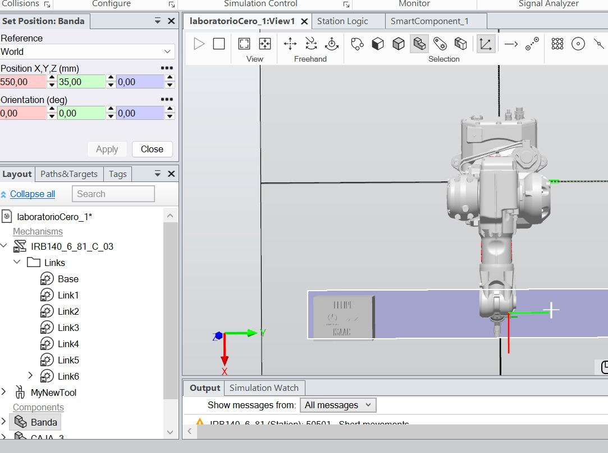
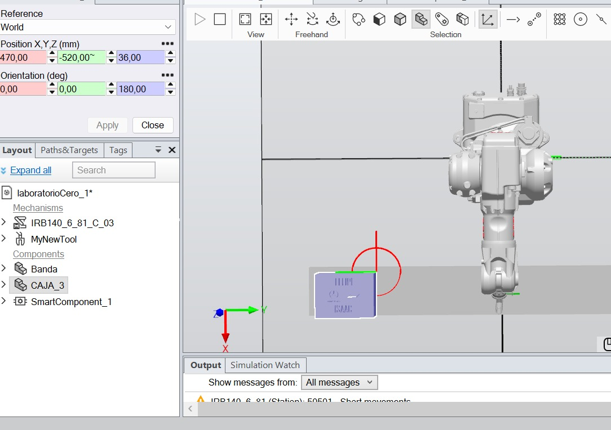
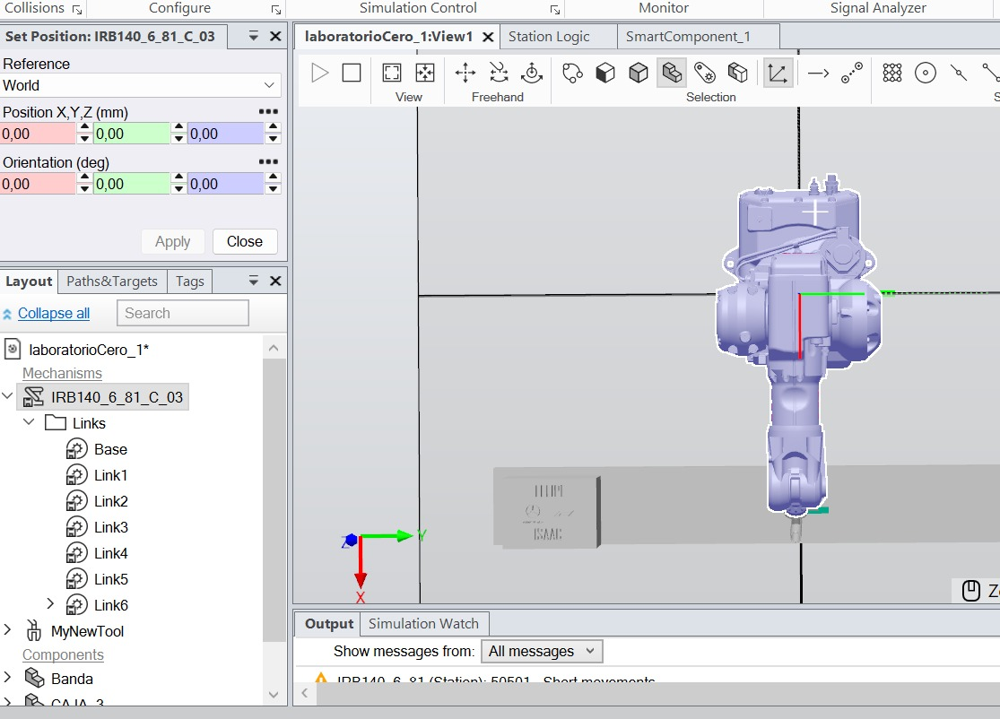
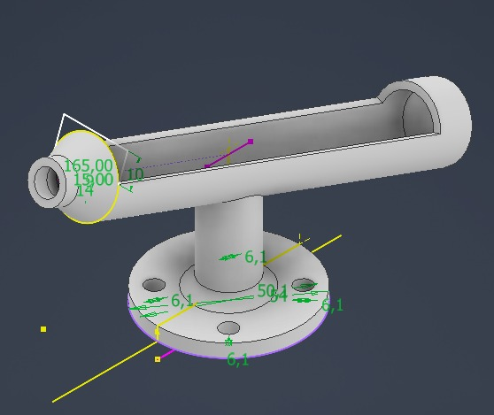
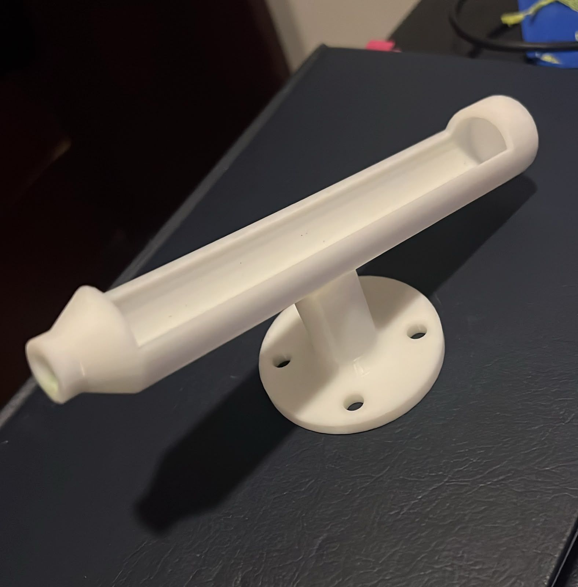
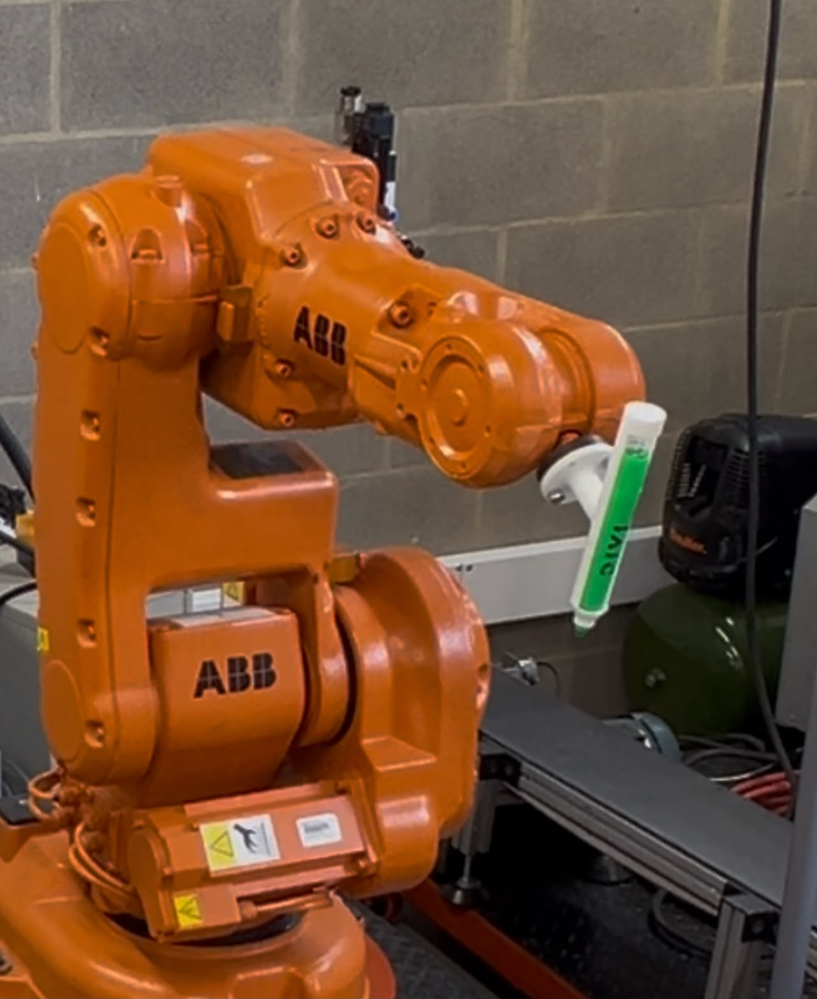

# Laboratorio No. 01 — Robótica Industrial: Trayectorias, Entradas y Salidas Digitales

**Robótica 2026-II · Universidad Nacional de Colombia**

| | |
|---|---|
| **Integrante 1** | Luis Felipe Vargas Bernal — luvargasbe@unal.edu.co |
| **Integrante B** | Isaac Jordán Oviedo - ijordan@unal.edu.co |
| **Robot** | ABB IRB 140 (controlador IRC5) |
| **Software** | RobotStudio, RAPID |
| **Fecha** | 30/10/2026 |
| **Video de la práctica** | [Enlace al video en el canal oficial de YouTube de LabSIR](https://youtu.be/JVfY9IiOYn8) |


---

## Tabla de contenido

1. [Descripción de la solución](#1-descripción-de-la-solución)
2. [Diagrama de flujo](#2-diagrama-de-flujo)
3. [Plano de planta](#3-plano-de-planta)
4. [Diseño de la herramienta](#4-diseño-de-la-herramienta)
5. [WorkObjects](#6-workobjects)
6. [Instrucciones y funciones RAPID utilizadas](#7-instrucciones-y-funciones-rapid-utilizadas)
7. [Código RAPID](#8-código-rapid)
8. [Restricciones y seguridad](#10-restricciones-y-seguridad)
9. [Video de la práctica](#11-video-de-la-práctica)
10. [Conclusiones](#12-conclusiones)


---

## 1. Descripción de la solución

### 1.1 Objetivo
Celda simplificada para la decoración automática de una torta virtual (superficie plana rectangular de 100 x 180 x 240 mm, equivalente aproximadamente a una torta para 20 personas) con un robot ABB IRB 140, integrada con una banda transportadora mediante señales digitales.
 

 
La decoración incluye:
 
- Los nombres de los integrantes, claramente separados.
- Una decoración adicional: logo de Marca Mercedez Benz, y de Formula 1.

 
### 1.2 Elementos de la celda
 
| Elemento | Descripción |
|---|---|
| Manipulador | ABB IRB 140 |
| Controlador | IRC5 |
| Módulo de E/S | DSQC 652 (3HAC025917-001/00) |
| Banda transportadora | Banda del Laboratorio |
| Herramienta | Soporte de marcador fijado al flange (impresión 3d) |
| Superficie de trabajo | [descripción] |
| Detección de posición | [tiempo de desplazamiento / sensor] |
 

 
### 1.3 Asignación de señales
 
| Señal | Tipo | Función |
|---|---|---|
| `DI_01` | Entrada | Inicia el ciclo automático de transporte y decoración |
| `DI_02` | Entrada | Lleva el robot a la pose de mantenimiento |
| `DI_03` | Entrada | Ejecuta la rutina *Farmear Aura* |
| `DO_01` | Salida | Activa mientras el robot ejecuta las trayectorias de decoración |
| `DO_02` | Salida | Activa mientras el robot permanece en la pose de mantenimiento |
| `DO_03` | Salida | Activa durante la rutina *Farmear Aura* |
| `FWD_Conveyor` | Salida | Banda en sentido de avance |
| `BWD_Conveyor` | Salida | Banda en sentido contrario |
 
Lógica de la banda:
 
| Estado | `FWD_Conveyor` | `BWD_Conveyor` |
|---|:---:|:---:|
| Adelante | 1 | 0 |
| Atrás | 0 | 1 |
| Detenida | 0 | 0 |
| **Prohibido** | 1 | 1 |
 
### 1.4 Secuencia del ciclo `DI_01`
 
1. Verificar que el robot esté en HOME y el pastel sobre la banda.
2. Activar la banda hacia la estación de decoración.
3. Detener completamente la banda cuando el pastel llegue a la posición de decoración (por [tiempo / sensor]).
4. `DO_01 = 1` y ejecución de la decoración (nombres + decoración adicional).
5. `DO_01 = 0` y retorno del robot a HOME.
6. Con el robot en posición segura, reactivar la banda.
7. Transportar el pastel decorado hasta el extremo final de la banda.
8. Detener la banda, desactivar las señales de movimiento y finalizar el ciclo.
<!-- EDITAR: paso 3, "tiempo" o "sensor" -->
 
### 1.5 Decoración
[Descripción del diseño, tipografía/trazos usados para los nombres, cómo se mantuvo el trazo continuo, velocidades y zonas empleadas.]
 
<!-- EDITAR: describe el diseño, cómo trazaste los nombres, qué speeddata/zonedata usaste -->
 

 
### 1.6 Rutina *Farmear Aura*
[Descripción de la coreografía: duración aproximada (10–20 s), movimientos `MoveJ`/`MoveL` usados, estructura de programación intermedia utilizada, retorno a HOME.]
 
<!-- EDITAR: sale directo de tu procedimiento FarmearAura -->
 
### 1.7 Pose de mantenimiento
[Descripción de la pose, valores articulares y por qué facilita instalar/retirar la herramienta e inspeccionar.]
 

---

## 2. Diagrama de flujo


## 3. Plano de planta





Elementos indicados en el plano:

- Base del robot ABB IRB 140 y su sistema de coordenadas base.
- Representación banda transportadora.
- Pastel de decoración sobre la banda.
- Sistema coordenado con referencia WORLD.

- Medidas generales de la banda 20x54x1200cm (ancho, alto, largo).
- Medidas generales del pastel 18x10x24cm (ancho, alto, largo).

---

## 4. Diseño de la herramienta

### 4.1 Requerimientos de diseño
- Fijar un marcador o plumón al flange del IRB 140.
- Permitir trazar sobre la superficie de forma estable y segura.
- Compensación por resorte, ajuste de altura, etc.

### 4.2 Descripción del diseño
[Descripción general, material, método de fabricación (p. ej. impresión 3D), forma de fijación al flange, ajuste del marcador.]

| Parámetro | Valor |
|---|---|
| Software CAD | Autodesk Inventor |
| Material | PLA  |
| Masa estimada | 30 g |


### 4.3 Imágenes

| Modelo CAD | Herramienta construida | Montada en el robot |
|---|---|---|
|  |  |  |

### 4.4 Archivos
- Modelo original: [`cad/herramienta.ipt`](CAD/portaMarcador.ipt)
- Exportación STL: [`cad/herramienta.stl`](CAD/portaMarcador.stl)
- Exportación SAT: [`cad/herramienta.sat`](CAD/roboticasintecho.sat)
- Planos de fabricación: [`cad/planos.pdf`](cad/planos.pdf)

---


## 6. WorkObjects

Todos los puntos de las trayectorias del programa están definidos respecto a un `wobjdata`, de modo que la misma rutina se reutiliza cambiando únicamente el sistema de coordenadas de referencia. En este laboratorio el WorkObject se definió de dos formas: en RobotStudio (`Workobject_1`) y con el robot real mediante el método de 3 puntos (`Wfeli`).

### 6.1 WorkObject utilizado en la práctica
Tanto la simulación como la ejecución en el robot real usan `Workobject_1`, es decir, la definición hecha en RobotStudio. La calibración física (`Wfeli`) se realizó para documentar el procedimiento y obtener los datos que pedía la práctica; se compara más abajo, pero el programa no la utiliza.

En el código, los trazos de la decoración y la rutina *Farmear Aura* se mueven con `\WObj:=Workobject_1`; el HOME y la pose de mantenimiento se definen respecto a `wobj0`.

### 6.2 Definición en RobotStudio: `Workobject_1`
- Método de definición: [cómo lo definiste en RobotStudio].
- `uframe`: origen en `[649.930, −460.000, 137.999]` mm y cuaternión `[0.017452, 0, 0.999848, 0]` (giro de 178° sobre Y, con el eje Z apuntando hacia abajo, hacia la superficie).
- `oframe`: desplazamiento de `[0, 0, −18.2]` mm.
- Origen efectivo del marco: `[649.295, −460.000, 156.188]` mm, en el cuadrante `x(+), y(−)`.

```rapid
TASK PERS wobjdata Workobject_1 := [FALSE,TRUE,"",[[649.930201004,-460,137.998781654],[0.017452407,0,0.999847695,0]],[[0,0,-18.2],[1,0,0,0]]];
```


### 6.3 Calibración con el robot real: `Wfeli`
Se definió con el método de 3 puntos (`X1`, `X2`, `Y1`):

| Punto | Posición `[x, y, z]` (mm) |
|---|---|
| `X1` | `[584.345, −241.788, 124.362]` |
| `X2` | `[410.747, −244.455, 124.953]` |
| `Y1` | `[588.688, 29.837, 127.407]` |

El origen queda en la proyección de `Y1` sobre la recta `X1–X2`: `[592.850, −241.657, 124.334]` mm, también en el cuadrante `x(+), y(−)`. El eje X va de `X1` hacia `X2` (sentido −x de la base) y el eje Y hacia `Y1`, por lo que el eje Z apunta hacia abajo, hacia la superficie. Los puntos cubren 173.6 mm en X y 271.5 mm en Y, con alturas entre 124.4 y 127.4 mm.

```rapid
TASK PERS wobjdata Wfeli := [FALSE,TRUE,"",[[0,0,0],[1,0,0,0]],[[592.85,-241.657,124.334],[0.00174513,0.00767284,-0.999953,-0.00564666]]];
```


### 6.4 Comparación

| Parámetro | `Workobject_1` (RobotStudio) | `Wfeli` (robot real) | Diferencia (real − RobotStudio) |
|---|---:|---:|---:|
| Origen X (mm) | 649.295 | 592.850 | −56.445 |
| Origen Y (mm) | −460.000 | −241.657 | +218.343 |
| Origen Z (mm) | 156.188 | 124.334 | −31.854 |
| Distancia entre orígenes (mm) | — | — | **227.8** |
| Giro del cuaternión sobre Y | 178.0° | 179.8° | — |
| Inclinación del eje Z respecto a la vertical | 2.0° | 0.7° | — |
| Giro relativo entre los dos marcos | — | — | 2.5° |

Los dos marcos tienen el eje Z hacia abajo y casi la misma orientación, pero sus orígenes están separados 227.8 mm en el plano y 31.9 mm en altura. 


## 7. Instrucciones y funciones RAPID utilizadas

| Instrucción / función | Tipo | Uso en este laboratorio |
|---|---|---|
| `MoveJ` | Movimiento | [Aproximaciones y desplazamientos libres] |
| `MoveL` | Movimiento | [Trazos de la decoración] |
| `MoveC` | Movimiento | [Arcos / círculos, si aplica] |
| `TaskPers` | Almaceniamiento de dato | [Persistente en la tarea] |
| `Pers` | Almaceniamiento de dato | [Persistente] |
| `Const` | Almaceniamiento de dato | [Constante, define los puntos] |
| `Target` | Indicador | [Punto en el espacio] |
| `Path` | Indicador | [Trayectoria definida por targets] |
| `Set` / `Reset` | E/S | [Control de `DO_01..03`, `FWD_Conveyor`, `BWD_Conveyor`] |
| `WaitTime` | Temporización | [Tiempos de transporte, tiempos muertos del enclavamiento] |
| `IF … ELSE … ENDIF` | Control | [Selección de modos, verificación] |
| `WHILE … ENDWHILE` | Control | [Bucle principal] |
| `PROC` / `ENDPROC` | Estructura | [Procedimientos modulares] |
| `TPWrite` / `TPErase` | FlexPendant | [Mensajes de estado] |
| `speeddata`, `zonedata` | Datos | [`v100`–`v1000`, zona máxima `z10`] |

### Procedimientos del programa

| Procedimiento | Función |
|---|---|
| `main` | Bucle principal; lectura de `DI_01`, `DI_02`, `DI_03` |
| `Mantenimiento` | Movimiento seguro a la pose de mantenimiento |
| `Decoracion` | Trayectorias de los nombres y la decoración adicional |
| `FarmearAura` | Rutina creativa |
| `HomeRobot` | Retorno a HOME |

---

## 8. Código RAPID


El código completo se encuentra en [`codigo/`](codigo/):

- [`codigo/Module1.mod`](codigo/Module1.mod)
- Respaldo completo de la estación: [`robotstudio/`](robotstudio/)

Fragmento representativo (movimiento de la banda en el ciclo de decoración):
 
```rapid
IF DI_02=1 THEN
    SET DO_02;
    SET BWD_Conveyor;
    WaitTime 3;
    RESET BWD_Conveyor;
    WaitTime 5;
    SET FWD_Conveyor;
    WaitTime 3;
    RESET FWD_Conveyor;
    Path_50;
    ! ... demás trazos ...
    Path_40;
    SET FWD_Conveyor;
    WaitTime 4;
    RESET FWD_Conveyor;
ENDIF
```
 
---

## 9. Restricciones y seguridad
 
| Requisito | Cómo se cumplió |
|---|---|
| Velocidades entre `v100` y `v1000` | `v100` en el acercamiento inicial (`Target_2450`) y la pose de mantenimiento, `v150` en *Farmear Aura*, `v200` en HOME y trazos |
| Zona máxima `z10` | `z1` en todos los movimientos |
| Rutina iniciada desde HOME | Cada vuelta del `WHILE TRUE` empieza con `Path_40` |
| Trazo continuo por palabra/elemento | Un procedimiento `Path_xx` por trazo; entre trazos el marcador se levanta a `Target_2380` (z = −24 mm) |
| Retorno a HOME al terminar | La decoración y el mantenimiento terminan con `Path_40`; tras *Farmear Aura* regresa al inicio de la siguiente vuelta del bucle |
| Nombres claramente separados | [separación utilizada] |
| Robot no decora con la banda en movimiento | `RESET FWD_Conveyor` antes de iniciar `Path_50`; los trazos se ejecutan con la banda detenida |
| Banda no se mueve hasta que el robot esté en posición segura | `Path_40` (HOME) antes del `SET FWD_Conveyor` final |
| Sin activación simultánea de `FWD` y `BWD` | Las activaciones son secuenciales: cada `SET` va precedido de un `RESET` y de una espera (`RESET BWD_Conveyor` + `WaitTime 5` antes de `SET FWD_Conveyor`) |
| Detener la banda antes de cambiar de sentido | `RESET BWD_Conveyor` y `WaitTime 5` antes de avanzar |
| Un solo modo activo a la vez | Los tres `IF` se evalúan en secuencia dentro del `WHILE`: un modo termina completo antes de evaluar el siguiente |
| Verificación previa en RobotStudio | [alcanzabilidad, límites articulares, colisiones] |
| Pruebas iniciales a velocidad reducida | [velocidad usada en las primeras pruebas] |
 
---

## 10. Video de la práctica


> El video se publica **únicamente** en el canal oficial de YouTube del Laboratorio LabSIR, a través del monitor de la asignatura. No se publica en canales personales.

[](URL_DEL_VIDEO)

**Enlace:** vide LabSIR(https://youtu.be/JVfY9IiOYn8)


---

## 11. Conclusiones
**Responsable: B (con revisión de A)**

- [Conclusión sobre la integración robot–banda mediante señales digitales.]
- [Conclusión sobre la calibración de la herramienta y las diferencias real vs. simulación.]
- [Conclusión sobre la reutilización de trayectorias con WorkObjects.]
- [Dificultades encontradas y cómo se resolvieron.]
- [Posibles mejoras: sensor de posición en lugar de tiempo, etc.]

---


*Universidad Nacional de Colombia · Robótica 2026-II · Laboratorio No. 01*

