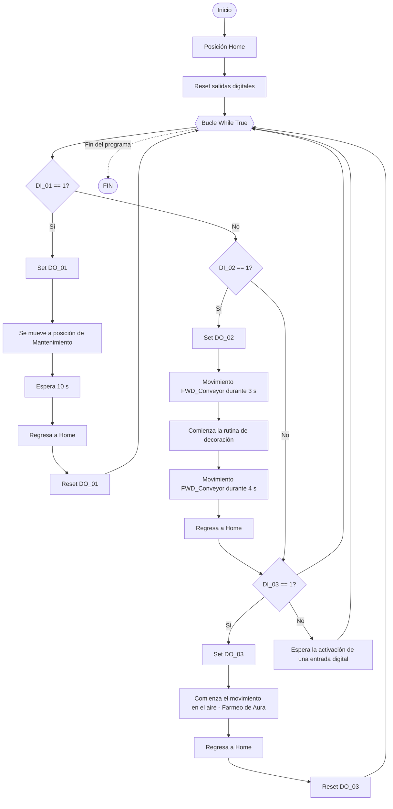

# Laboratorio No. 01 — Robótica Industrial: Trayectorias, Entradas y Salidas Digitales

**Robótica 2026-II · Universidad Nacional de Colombia**

| | |
|---|---|
| **Integrante 1** | Luis Felipe Vargas Bernal — luvargasbe@unal.edu.co |
| **Integrante B** | Isaac Jordán Oviedo - ijordan@unal.edu.co |
| **Robot** | ABB IRB 140 (controlador IRC5) |
| **Software** | RobotStudio, RAPID |
| **Fecha** | [30/10/2026] |
| **Video de la práctica** | [Enlace al video en el canal oficial de YouTube de LabSIR](https://youtu.be/JVfY9IiOYn8) |


---

## Tabla de contenido

1. [Descripción de la solución](#1-descripción-de-la-solución)
2. [Diagrama de flujo](#2-diagrama-de-flujo)
3. [Plano de planta](#3-plano-de-planta)
4. [Diseño de la herramienta](#4-diseño-de-la-herramienta)
5. [Calibración de la herramienta: real vs. RobotStudio](#5-calibración-de-la-herramienta-real-vs-robotstudio)
6. [WorkObjects](#6-workobjects)
7. [Instrucciones y funciones RAPID utilizadas](#7-instrucciones-y-funciones-rapid-utilizadas)
8. [Código RAPID](#8-código-rapid)
9. [Evidencia de funcionamiento](#9-evidencia-de-funcionamiento)
10. [Restricciones y seguridad](#10-restricciones-y-seguridad)
11. [Video de la práctica](#11-video-de-la-práctica)
12. [Conclusiones](#12-conclusiones)
13. [Estructura del repositorio](#13-estructura-del-repositorio)

---

## 1. Descripción de la solución
**Responsable: A**
 
### 1.1 Objetivo
Celda simplificada para la decoración automática de una torta virtual (superficie plana [circular / rectangular] de [dimensiones] mm, equivalente aproximadamente a una torta para 20 personas) con un robot ABB IRB 140, integrada con una banda transportadora mediante señales digitales.
 
<!-- EDITAR: forma y dimensiones de la torta -->
 
La decoración incluye:
 
- Los nombres de los integrantes, claramente separados.
- Una decoración adicional: [describir el diseño elegido].
<!-- EDITAR: el diseño adicional que hiciste -->
 
### 1.2 Elementos de la celda
 
| Elemento | Descripción |
|---|---|
| Manipulador | ABB IRB 140 |
| Controlador | IRC5 |
| Módulo de E/S | DSQC 652 (3HAC025917-001/00) |
| Banda transportadora | [modelo, sentido de avance, variador de frecuencia] |
| Herramienta | Soporte de marcador/plumón fijado al flange |
| Superficie de trabajo | [descripción] |
| Detección de posición | [tiempo de desplazamiento / sensor] |
 
<!-- EDITAR: banda, superficie de trabajo y detección de posición (en el código, ¿WaitTime o sensor?) -->
 
### 1.3 Asignación de señales
 
| Señal | Tipo | Función |
|---|---|---|
| `DI_01` | Entrada | Inicia el ciclo automático de transporte y decoración |
| `DI_02` | Entrada | Lleva el robot a la pose de mantenimiento |
| `DI_03` | Entrada | Ejecuta la rutina *Farmear Aura* |
| `DO_01` | Salida | Activa mientras el robot ejecuta las trayectorias de decoración |
| `DO_02` | Salida | Activa mientras el robot permanece en la pose de mantenimiento |
| `DO_03` | Salida | Activa durante la rutina *Farmear Aura* |
| `FWD_Conveyor` | Salida | Banda en sentido de avance |
| `BWD_Conveyor` | Salida | Banda en sentido contrario |
 
Lógica de la banda:
 
| Estado | `FWD_Conveyor` | `BWD_Conveyor` |
|---|:---:|:---:|
| Adelante | 1 | 0 |
| Atrás | 0 | 1 |
| Detenida | 0 | 0 |
| **Prohibido** | 1 | 1 |
 
### 1.4 Secuencia del ciclo `DI_01`
 
1. Verificar que el robot esté en HOME y el pastel sobre la banda.
2. Activar la banda hacia la estación de decoración.
3. Detener completamente la banda cuando el pastel llegue a la posición de decoración (por [tiempo / sensor]).
4. `DO_01 = 1` y ejecución de la decoración (nombres + decoración adicional).
5. `DO_01 = 0` y retorno del robot a HOME.
6. Con el robot en posición segura, reactivar la banda.
7. Transportar el pastel decorado hasta el extremo final de la banda.
8. Detener la banda, desactivar las señales de movimiento y finalizar el ciclo.
<!-- EDITAR: paso 3, "tiempo" o "sensor" -->
 
### 1.5 Decoración
[Descripción del diseño, tipografía/trazos usados para los nombres, cómo se mantuvo el trazo continuo, velocidades y zonas empleadas.]
 
<!-- EDITAR: describe el diseño, cómo trazaste los nombres, qué speeddata/zonedata usaste -->
 

 
### 1.6 Rutina *Farmear Aura*
[Descripción de la coreografía: duración aproximada (10–20 s), movimientos `MoveJ`/`MoveL` usados, estructura de programación intermedia utilizada, retorno a HOME.]
 
<!-- EDITAR: sale directo de tu procedimiento FarmearAura -->
 
### 1.7 Pose de mantenimiento
[Descripción de la pose, valores articulares y por qué facilita instalar/retirar la herramienta e inspeccionar.]
 
<!-- EDITAR: valores articulares del MoveAbsJ de PoseMantenimiento -->
 
---

## 2. Diagrama de flujo


## 3. Plano de planta
**Responsable: B**


Elementos indicados en el plano:

- Base del robot ABB IRB 140 y su sistema de coordenadas base.
- Banda transportadora, con sentido de avance, extremo inicial y extremo final.
- Estación de decoración sobre la banda.
- Superficies de trabajo en los cuadrantes `x(+), y(+)` y `x(+), y(−)`.
- Zona de interacción robot–banda y posición HOME.
- Otros elementos de la celda: [mesas, gabinete del controlador, etc.].

| Dato | Valor |
|---|---|
| Distancia base del robot – estación de decoración | [mm] |
| Dimensiones de la superficie de trabajo | [mm] |
| Longitud útil de la banda | [mm] |

---

## 4. Diseño de la herramienta
**Responsable: B**

### 4.1 Requerimientos de diseño
- Fijar un marcador o plumón al flange del IRB 140.
- Permitir trazar sobre la superficie de forma estable y segura.
- [Otros: compensación por resorte, ajuste de altura, etc.]

### 4.2 Descripción del diseño
[Descripción general, material, método de fabricación (p. ej. impresión 3D), forma de fijación al flange, ajuste del marcador.]

| Parámetro | Valor |
|---|---|
| Software CAD | [Autodesk Inventor / otro] |
| Material | [PLA / otro] |
| Masa estimada | [g] |
| Distancia flange – punta del marcador | [mm] |

### 4.3 Imágenes

| Modelo CAD | Herramienta construida | Montada en el robot |
|---|---|---|
|  |  |  |

### 4.4 Archivos
- Modelo original: [`cad/herramienta.ipt`](cad/herramienta.ipt)
- Exportación STL: [`cad/herramienta.stl`](cad/herramienta.stl)
- Exportación SAT: [`cad/herramienta.sat`](cad/herramienta.sat)
- Planos de fabricación: [`cad/planos.pdf`](cad/planos.pdf)

---

## 5. Calibración de la herramienta: real vs. RobotStudio

### 5.1 Calibración con el robot real
**Responsable: B**

- **Técnica de calibración elegida:** [TCP de 4 puntos / 5 puntos / 6 puntos (TCP&Z / TCP&Z,X)] y por qué es la más apropiada para este caso.
- **Procedimiento:** [pasos seguidos en el FlexPendant, punto de referencia fijo utilizado, número de aproximaciones y orientaciones].
- **Error medio / error máximo reportado por el controlador:** [mm].

```rapid
PERS tooldata MiHerramienta := [TRUE,[[x,y,z],[q1,q2,q3,q4]],[masa,[cx,cy,cz],[1,0,0,0],0,0,0]];
```

### 5.2 Calibración en RobotStudio
**Responsable: A**

- Importación del modelo CAD (`.stl` / `.sat`) y ajuste de su posición respecto al flange.
- Método de definición del TCP en RobotStudio: [creación de la herramienta con el modelo / frame de herramienta].
- Valores obtenidos:

```rapid
PERS tooldata MiHerramienta_RS := [TRUE,[[x,y,z],[q1,q2,q3,q4]],[masa,[cx,cy,cz],[1,0,0,0],0,0,0]];
```


### 5.3 Comparación
**Responsable: B**

| Parámetro | Robot real | RobotStudio | Diferencia |
|---|---:|---:|---:|
| `tframe.trans.x` (mm) | | | |
| `tframe.trans.y` (mm) | | | |
| `tframe.trans.z` (mm) | | | |
| `tframe.rot.q1` | | | |
| `tframe.rot.q2` | | | |
| `tframe.rot.q3` | | | |
| `tframe.rot.q4` | | | |
| `tload.mass` (kg) | | | |
| `tload.cog.x` (mm) | | | |
| `tload.cog.y` (mm) | | | |
| `tload.cog.z` (mm) | | | |

### 5.4 Análisis de las diferencias
Posibles causas identificadas:

- [Tolerancias de fabricación de la herramienta frente al modelo CAD.]
- [Holguras o desajuste en la fijación al flange.]
- [Error de apuntado del operador durante la calibración real.]
- [Posicionamiento del modelo CAD en RobotStudio respecto al flange.]
- [Masa y centro de gravedad estimados vs. medidos.]

[Conclusión sobre cuál calibración es más confiable y por qué.]

---

## 6. WorkObjects
**Responsable: A**

La misma rutina de decoración se programa respecto a un `wobjdata` y se reutiliza cambiando únicamente el sistema de coordenadas de referencia.

| WorkObject | Ubicación | Uso |
|---|---|---|
| `[WorkObject_1]` | Cuadrante `x(+), y(+)` | [Estación de decoración en la banda / superficie fija] |
| `[WorkObject_2]` | Cuadrante `x(+), y(−)` | [Estación de decoración en la banda / superficie fija] |

- Método de definición del `wobjdata`: [3 puntos: X1, X2, Y1].
- Una de las posiciones corresponde a la estación de decoración sobre la banda: [cuál].

```rapid
PERS wobjdata WorkObject_1 := [FALSE,TRUE,"",[[x,y,z],[q1,q2,q3,q4]],[[0,0,0],[1,0,0,0]]];
PERS wobjdata WorkObject_2 := [FALSE,TRUE,"",[[x,y,z],[q1,q2,q3,q4]],[[0,0,0],[1,0,0,0]]];
```


---

## 7. Instrucciones y funciones RAPID utilizadas
**Responsable: A**

| Instrucción / función | Tipo | Uso en este laboratorio |
|---|---|---|
| `MoveJ` | Movimiento | [Aproximaciones y desplazamientos libres] |
| `MoveL` | Movimiento | [Trazos de la decoración] |
| `MoveC` | Movimiento | [Arcos / círculos, si aplica] |
| `MoveAbsJ` | Movimiento | [HOME y pose de mantenimiento] |
| `CRobT` | Función | [Lectura de la posición actual] |
| `CalcJointT` | Función | [Verificación de alcanzabilidad] |
| `Set` / `Reset` | E/S | [Control de `DO_01..03`, `FWD_Conveyor`, `BWD_Conveyor`] |
| `WaitTime` | Temporización | [Tiempos de transporte, tiempos muertos del enclavamiento] |
| `WaitDI` / lectura de `DI_xx` | E/S | [Detección de las entradas] |
| `IF … ELSE … ENDIF` | Control | [Selección de modos, verificación] |
| `FOR … ENDFOR` | Control | [Repeticiones en *Farmear Aura*] |
| `WHILE … ENDWHILE` | Control | [Bucle principal] |
| `PROC` / `ENDPROC` | Estructura | [Procedimientos modulares] |
| `ERROR` / `TRYNEXT` / `ERRNO` | Errores | [Manejo básico de errores] |
| `TPWrite` / `TPErase` | FlexPendant | [Mensajes de estado] |
| `speeddata`, `zonedata` | Datos | [`v100`–`v1000`, zona máxima `z10`] |

### Procedimientos del programa

| Procedimiento | Función |
|---|---|
| `main` | Bucle principal; lectura de `DI_01`, `DI_02`, `DI_03` |
| `CicloDecoracion` | Secuencia completa del ciclo `DI_01` |
| `RutinaDecoracion` | Trayectorias de los nombres y la decoración adicional |
| `PoseMantenimiento` | Movimiento seguro a la pose de mantenimiento |
| `FarmearAura` | Rutina creativa |
| `HomeRobot` | Retorno a HOME con `MoveAbsJ` |
| `ConveyorForward` / `ConveyorBackward` / `ConveyorStop` | Control de la banda con enclavamiento |

---

## 8. Código RAPID


El código completo se encuentra en [`codigo/`](codigo/):

- [`codigo/Module1.mod`](codigo/Module1.mod)
- Respaldo completo de la estación: [`robotstudio/`](robotstudio/)

Fragmento representativo (movimiento de la banda en el ciclo de decoración):
 
```rapid
IF DI_02=1 THEN
    SET DO_02;
    SET BWD_Conveyor;
    WaitTime 3;
    RESET BWD_Conveyor;
    WaitTime 5;
    SET FWD_Conveyor;
    WaitTime 3;
    RESET FWD_Conveyor;
    Path_50;
    ! ... demás trazos ...
    Path_40;
    SET FWD_Conveyor;
    WaitTime 4;
    RESET FWD_Conveyor;
ENDIF
```
 
---

## 10. Restricciones y seguridad
 
| Requisito | Cómo se cumplió |
|---|---|
| Velocidades entre `v100` y `v1000` | `v100` en el acercamiento inicial (`Target_2450`) y la pose de mantenimiento, `v150` en *Farmear Aura*, `v200` en HOME y trazos |
| Zona máxima `z10` | `z1` en todos los movimientos |
| Rutina iniciada desde HOME | Cada vuelta del `WHILE TRUE` empieza con `Path_40` |
| Trazo continuo por palabra/elemento | Un procedimiento `Path_xx` por trazo; entre trazos el marcador se levanta a `Target_2380` (z = −24 mm) |
| Retorno a HOME al terminar | La decoración y el mantenimiento terminan con `Path_40`; tras *Farmear Aura* regresa al inicio de la siguiente vuelta del bucle |
| Nombres claramente separados | [separación utilizada] |
| Robot no decora con la banda en movimiento | `RESET FWD_Conveyor` antes de iniciar `Path_50`; los trazos se ejecutan con la banda detenida |
| Banda no se mueve hasta que el robot esté en posición segura | `Path_40` (HOME) antes del `SET FWD_Conveyor` final |
| Sin activación simultánea de `FWD` y `BWD` | Las activaciones son secuenciales: cada `SET` va precedido de un `RESET` y de una espera (`RESET BWD_Conveyor` + `WaitTime 5` antes de `SET FWD_Conveyor`) |
| Detener la banda antes de cambiar de sentido | `RESET BWD_Conveyor` y `WaitTime 5` antes de avanzar |
| Un solo modo activo a la vez | Los tres `IF` se evalúan en secuencia dentro del `WHILE`: un modo termina completo antes de evaluar el siguiente |
| Verificación previa en RobotStudio | [alcanzabilidad, límites articulares, colisiones] |
| Pruebas iniciales a velocidad reducida | [velocidad usada en las primeras pruebas] |
 
---

## 11. Video de la práctica


> El video se publica **únicamente** en el canal oficial de YouTube del Laboratorio LabSIR, a través del monitor de la asignatura. No se publica en canales personales.

[](URL_DEL_VIDEO)

**Enlace:** vide LabSIR(https://youtu.be/JVfY9IiOYn8)


---

## 12. Conclusiones
**Responsable: B (con revisión de A)**

- [Conclusión sobre la integración robot–banda mediante señales digitales.]
- [Conclusión sobre la calibración de la herramienta y las diferencias real vs. simulación.]
- [Conclusión sobre la reutilización de trayectorias con WorkObjects.]
- [Dificultades encontradas y cómo se resolvieron.]
- [Posibles mejoras: sensor de posición en lugar de tiempo, etc.]

---


*Universidad Nacional de Colombia · Robótica 2026-II · Laboratorio No. 01*

