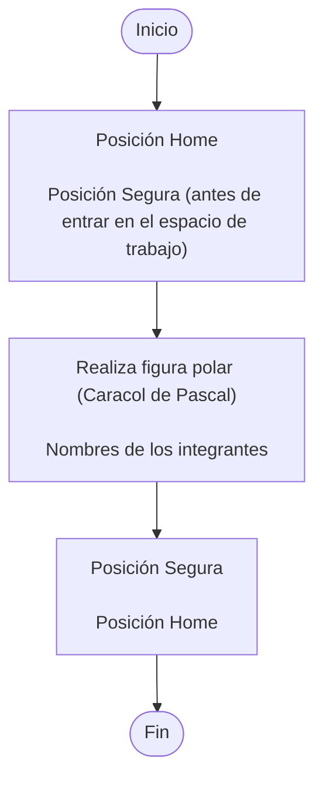

# Tabla de contenido
1. [Cuadro comparativo Motoman MH6 y ABB IRB140](#1--cuadro-comparativo-motoman-mh6-y-abb-irb140)
2. [Configuraciones Home1 y Home2](#2--configuraciones-home1-y-home2)
3. [Movimientos manuales y niveles de velocidad](#3--movimientos-manuales-y-niveles-de-velocidad)
4. [Funcionalidades RoboDK](#4--funcionalidades-robodk)
5. [Comparación entre RoboDK y RobotStudio](#5--comparación-entre-robodk-y-robotstudio)
6. [Diagrama de flujo rutina](#6--diagrama-de-flujo-rutina)
7. [Plano de planta](#7--plano-de-planta)
8. [Código de la rutina y video](#8--código-de-la-rutina-y-video)

## 1.- Cuadro comparativo Motoman MH6 y ABB IRB140

<!-- POR TERMINAR -->

## 2.- Configuraciones Home1 y Home2

El robot Motoman MH6 cuenta con dos posiciones de Home. La primera posición está dedicada a la comodidad para transportar el robot, mientras que la segunda posición está dedicada al inicio de trabajo. Ambas posiciones tienen una funcionalidad específica para diferentes tareas, por eso ninguna es mejor que la otra, cada una es necesaria para su propia tarea. 
| Articulación | Home1 (°) | Home2 (°) |
| --- | --- | --- |
| S | 0 | 0 |
| L | -115290 | 2037 |
| U | -111622 | 2359 |
| R | 1 | 0 |
| B | 42647 | -121 |
| T | 1392 | 1392 |


## 3.- Movimientos manuales y niveles de velocidad

Para realizar movimientos manuales se debe seguir la siguiente lista de pasos:
1. Apretar el botón de **parada de emergencia**
2. Girar la llave hasta la opción **TEACH**
3. Desbloquear el botón de **parada de emergencia**
4. Pulsar el botón **Servo on ready**
5. En la pantalla seleccionar al lado izquierdo la pestaña de **robot**
6. Seleccionar el tipo de movimiento **articular**
7. Mover cada articulación con las teclas correspondientes (S$\pm$;L$\pm$;U$\pm$;R$\pm$;B$\pm$;T$\pm$;E$\pm$;8$\pm$;)

<!-- EXPLICAR AQUI COMO CAMBIAR DE ARTICULAR A LINEAR O ROTACIONAL -->

Para modificar la velocidad del robot se encuentran los botones **FAST** y **SLOW**. Cada uno incrementa o decrementa respectivamente el nivel de la velocidad. Existen tres niveles: low, medium y high; y se indican en el teach pendant en la parte superior con un triángulo formado por tres barras verdes acompañadas de una letra. Cada barra pintada indica el nivel de velocidad en el que se encuentra: una barra indica la mínima velocidad y tres barras completan la velocidad máxima.

## 4.- Funcionalidades RoboDK

El software RoboDK permite simular y programar offline diversidad de robots industriales. Reproduce el manipulador, herramienta y espacios de trabajo en 3D, permitiendo verificar alcance, singularidades e incluso colisiones en un espacio seguro. Otorga la posibilidad de programar desde el PC en código Python. Es posible realizar cinemática inversa y directa, además de calibrar herramientas o marcos de referencia. Desde el software se puede controlar de manera remota el robot Motoman. Acepta archivos CAD para diseñar entornos de trabajo.
El manipulador Motoman MH6 permite su control de manera remota a través de RoboDK. Fundamentalmente con las líneas de código:

```python
#------------------------------------------------
# 1) Conexión a RoboDK e inicialización
#------------------------------------------------
RDK = Robolink()

# Elegir un robot (si hay varios, aparece un popup)
robot = RDK.ItemUserPick("Selecciona un robot", ITEM_TYPE_ROBOT)
if not robot.Valid():
    raise Exception("No se ha seleccionado un robot válido.")

# Conectar al robot físico
if not robot.Connect():
    raise Exception("No se pudo conectar al robot. Verifica que esté en modo remoto y que la configuración sea correcta.")

# Confirmar conexión
if not robot.ConnectedState():
    raise Exception("El robot no está conectado correctamente. Revisa la conexión.")

print("Robot conectado correctamente.")
```

Dentro de RoboDK en la pestaña superior **Conectar -> Conectar Robot -> Robot IP -> Ping -> Conectar**
Los movimientos con los que cuenta son: **MoveJ** y **MoveL** para dirigirse a un punto directamente y para realizar una trayectoria lineal respectivamente. Adicionalmente existe la opción MoveC para trayectorias circulares. Es necesario haber creado puntos previamente, ya sea con la opción target o con funciones matemáticas de las librerías de Python.

## 5.- Comparación entre RoboDK y RobotStudio

## 6.- Diagrama de flujo rutina


## 7.- Plano de planta

## 8.- Código de la rutina y video

